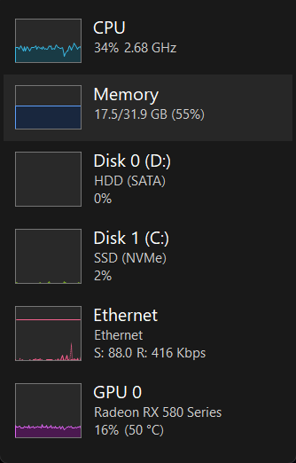
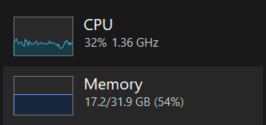

# Compact Task Manager

Open Windows 11 Task Manager automatically in **dark Performance Summary view** after signing in. CPU, memory, disks, network, and GPU graphs stay in a small, always-on-top window.

No downloads beyond this project, no telemetry, no resident helper. A Windows scheduled task opens Task Manager, locates the CPU sidebar through accessibility, double-clicks it, positions the compact window, and exits.

## Screenshots

Actual Windows 11 Task Manager in dark Summary view. Only the widget's client area is captured; no desktop or other applications are included. Hardware and readings are illustrative and will differ on your PC. These images show the working original helper, not a claim of installer verification on every supported configuration.



<details>
<summary>CPU and memory close-up</summary>



</details>

## Diagnose with one command

From this checkout, run:

```powershell
.\Diagnose.ps1
```

The command is **read-only**: it does not install, elevate, change settings, start tasks, or move windows. It prints one JSON object with `schemaVersion`, `status`, `compatibility`, `installation`, `lastRun`, `errors`, and `nextAction`. It normally runs without administrator privileges. Use 64-bit Windows PowerShell 5.1 for the full supported check; other environments are reported rather than installed into.

An agent can consume the result directly:

```powershell
$report = .\Diagnose.ps1 | ConvertFrom-Json
$report.status
$report.nextAction.code
$report.nextAction.message
```

Key outcomes:

| Status | What to do next |
| --- | --- |
| `unsupported` / `wrong_shell` | Use the supported Windows platform / native Windows PowerShell. |
| `not_installed` / `partial_installation` | Review and install or repair with human-approved administrator privileges. |
| `legacy_installation` | Review the original personal helper before adding another startup task. |
| `invalid_configuration` / `disabled` | Fix the config or enable the task, as requested by the user. |
| `running` / `not_tested` | Wait for completion, or run the task once, then diagnose again. |
| `failed` / `unverified` | Inspect the local log or obtain a matching fresh run. |
| `healthy` | The latest completed task and matching log agree on success. Visually verify the widget. |
| `unknown` | One or more checks failed; inspect the error codes before drawing conclusions. |

`nextAction` includes a stable `code`, a human-readable `message`, and `requiresElevation`. These are recommendations, not authorization for an agent to act. `visualVerification` is always `not_performed`: the command does not inspect pixels or claim to have tested sign-in. A previous successful run does not prove the widget is currently visible.

Exit code `0` means the diagnostic checks completed, **not** that the installation is healthy. Exit code `1` means a check failed. Parse `status` for application health. Raw logs, account names, SIDs, and personal paths are not emitted; OS/architecture and task result information are included.

New installations also include the command in the installed directory:

```powershell
$sid = [Security.Principal.WindowsIdentity]::GetCurrent().User.Value
& "$env:ProgramFiles\CompactTaskManager\$sid\Diagnose.ps1"
```

## Can my AI agent set this up?

**Yes, if it can run local commands on your Windows PC.** Installation and removal use PowerShell scripts, preferences use JSON, and verification uses Task Scheduler and a local log. No particular AI provider or model is required.

This is currently **scriptable, not fully unattended**. An agent running without administrator privileges needs you to approve elevation or run the installation command yourself. The widget also needs an unlocked Windows desktop. A cloud-only agent, a headless CI runner, or an agent without access to your PC cannot complete the desktop setup by itself.

You can give your agent this prompt:

> Set up Compact Task Manager from https://github.com/omoladeodetara/compact-task-manager on this PC. Read its README and scripts first. Check Windows version, architecture, PowerShell version, and whether your session has administrator privileges. Use the default upper-right position unless I specify another. Run the tests, then install for my Windows account. Let me approve any required administrator prompt; do not bypass security controls. Verify a fresh scheduled run and, if you can inspect the desktop, confirm dark Performance Summary view. Tell me what you verified, what remains untested, and how to uninstall it.

### Agent setup checklist

1. **Check the environment.** Run `Diagnose.ps1` and read its JSON report, then use the compatibility table below. Installation requires native 64-bit Windows PowerShell 5.1, not merely any shell named PowerShell. Elevate as the intended Windows user, not a different administrator account.
2. **Inspect before running.** Read `Install.ps1`, `src/Start-CompactTaskManager.ps1`, `src/Common.ps1`, and `Uninstall.ps1`. Run `tests/Test.ps1`; these checks do not install anything or exercise the desktop.
3. **Check for an existing setup.** Inspect this user's `Compact Task Manager (<SID>)` task and configuration. Reinstallation updates the installed scripts and task, but preserves an existing `config.json`. Do not create additional startup shortcuts or unrelated tasks.
4. **Install with user authorization.** Follow the installation section. `-StartNow` starts the task asynchronously; installer success alone does not prove the widget opened. The task closes and reopens Task Manager to apply its settings. Never interact with UAC prompts on the user's behalf, disable UAC, or weaken execution policies to finish setup.
5. **Verify a fresh run.** Wait for the task to finish, then inspect its Last Run Time, Last Run Result, and the timestamped log. Confirm the results belong to the run you just requested. If desktop inspection is available, verify dark Summary view and placement as well. Otherwise explicitly report that visual appearance was not verified.
6. **Report the result.** Give the user the task name, config location, observed result, and uninstall command. Keep personal paths, logs, settings backups, and screenshots out of public commits and issue reports.

These are read-only verification commands, run after the task finishes:

```powershell
$sid = [Security.Principal.WindowsIdentity]::GetCurrent().User.Value
$task = Get-ScheduledTask -TaskName "Compact Task Manager ($sid)"
$info = $task | Get-ScheduledTaskInfo
[pscustomobject]@{
    TaskName = $task.TaskName
    State = [string]$task.State
    LastRunTime = $info.LastRunTime
    LastTaskResult = $info.LastTaskResult
} | ConvertTo-Json
Get-Content -LiteralPath "$env:USERPROFILE\CompactTaskManager\last-run.log"
```

A completed fresh run with result `0` and a matching `SUCCESS` log means the helper's checks passed. This does not replace visual verification or prove the next sign-in has been tested. Never describe a queued or still-running task as a successful installation test.

## Does it work across operating systems?

**No. This implementation automates Windows Task Manager; it is not a cross-platform system monitor.** It depends on Windows Task Scheduler, Windows UI Automation, Win32 window/input APIs, and Task Manager's settings and controls. Installing PowerShell on another OS does not provide those components.

| Platform | Status |
| --- | --- |
| Windows 11 22H2 or newer, x64 | Intended target. Original workflow tested on build 26200; generalized installer and other builds need further testing. |
| Windows 11 ARM64 | Not verified or supported by this release. |
| Windows 10 and older | Unsupported; the legacy Task Manager has different UI and theme behavior. |
| macOS | Unsupported. Activity Monitor would require a separate implementation. |
| Linux | Unsupported. Monitoring UI and startup integration would require a separate implementation. |
| WSL, Windows Server, or headless environments | Unsupported deployment environments for this desktop helper. |

Agents can help adapt the idea to another OS, but that would be new development—not an installation option this repository already provides.

## Requirements

- Windows 11 22H2 or newer, x64, with the modern Task Manager.
- Windows PowerShell 5.1 (included with Windows).
- An administrator account; install from an elevated PowerShell window **as the same user who will use the widget**.
- An unlocked interactive desktop. The helper briefly takes focus and moves the pointer, then restores its previous position.

The original workflow was tested on Windows 11 build 26200. Other Windows builds, languages, ARM64, and mixed-DPI layouts have not been verified. This is an experimental v0.1 release; Task Manager's UI and settings format are not stable public APIs.

## Install

Download and extract the repository, or clone it:

```powershell
git clone https://github.com/omoladeodetara/compact-task-manager.git
cd compact-task-manager
```

Review the scripts, then open **64-bit Windows PowerShell as administrator** in that folder:

```powershell
.\Install.ps1 -StartNow
```

If Windows marks downloaded scripts as blocked, review them and use the file's Properties > Unblock. This project does not disable execution policies or change UAC settings. Organization-managed execution policies still apply.

The installer copies executable scripts into an administrator-protected subdirectory of Program Files and creates a per-user task named `Compact Task Manager (<your SID>)`. It runs 15 seconds after sign-in. `-StartNow` also tests it immediately; omit the switch to wait until your next sign-in.

The helper gracefully closes an existing Task Manager instance before reopening it, so dark mode and the Performance start page are applied consistently. It does not stop any applications listed inside Task Manager.

## Position and size

Edit `%USERPROFILE%\CompactTaskManager\config.json`:

```json
{
  "X": null,
  "Y": null,
  "Height": 540,
  "AlwaysOnTop": true
}
```

- Leave X and Y null for the primary monitor's upper-right corner.
- Set both to integer screen coordinates (physical pixels) for a preferred location. Negative coordinates are supported.
- Height accepts 200–4000 pixels. Increase it if your PC has more devices than fit in the window.
- The window is clamped to the nearest available screen's working area if the preferred screen is missing.
- Set AlwaysOnTop to false to let other windows cover it.

To apply changes, run the task from Task Scheduler, or use:

```powershell
$sid = [Security.Principal.WindowsIdentity]::GetCurrent().User.Value
Start-ScheduledTask -TaskName "Compact Task Manager ($sid)"
```

## Uninstall

From an elevated 64-bit Windows PowerShell window, run `Uninstall.ps1` in this checkout, or the installed copy:

```powershell
$sid = [Security.Principal.WindowsIdentity]::GetCurrent().User.Value
& "$env:ProgramFiles\CompactTaskManager\$sid\Uninstall.ps1"
```

This removes the scheduled task and its known script files. It leaves your configuration, logs, and Task Manager preferences in place. The helper saves the original settings as `%USERPROFILE%\CompactTaskManager\settings-before.json` when available. Restore that backup manually only with Task Manager closed, if desired.

## Why a startup shortcut is not enough

On the tested Windows build, Task Manager remembers its start page but does not reopen in Performance Summary view. Task Manager also elevates itself, preventing ordinary automation from interacting with it. The scheduled task runs at the required privilege level in the user's interactive session.

Two implementation traps informed this project:

1. A 32-bit launcher may redirect `System32` to `SysWOW64` and open the older Task Manager. The helper explicitly uses native Windows PowerShell.
2. Packaged applications can virtualize AppData paths. A file visible to an app may not exist at that path for Task Scheduler. Installed code lives in Program Files; runtime configuration and logs live directly beneath the user profile.

The helper finds controls by automation ID, verifies the click target's process, and checks that the navigation UI disappeared while the CPU sidebar remains. It fails rather than intentionally clicking a different application. Do not interact with the pointer while the startup sequence is running.

## Troubleshooting and limits

- Read `%USERPROFILE%\CompactTaskManager\last-run.log` and the task's Last Run Result; `0` indicates success.
- If foreground activation fails, unlock the desktop and run the task again.
- If it opens in full view after a Windows update, the control identifiers may have changed. File an issue with your Windows build and the error text; redact personal paths.
- Dark mode and the Performance start page are written to Task Manager's settings JSON before launch. A Windows update may change that format.
- Turning a monitor off/on or waking from sleep is not a separate trigger. This release runs at sign-in or on manual task invocation.
- This is an independent project, not a Microsoft product.

## Development

```powershell
.\tests\Test.ps1
```

Tests cover PowerShell syntax, config validation, and placement on screens with negative coordinates or insufficient room. GitHub Actions runs these checks on Windows. CI does **not** validate desktop clicks or install elevated tasks; use the [manual test checklist](CONTRIBUTING.md) for those.

Only the reviewed documentation screenshots in `docs/images/` are committed. UI dumps, user settings, logs, and other captures remain excluded. The distributed helper and diagnostic command do not capture screenshots or send network requests.

## License

[MIT](LICENSE).
